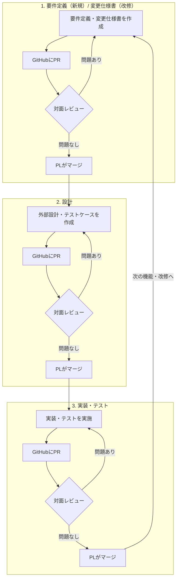

# 利用者向け説明書（Claude Code 開発テンプレート）

このテンプレートを使って開発を進める人のための説明書です。
テンプレートの概要は [README.md](README.md)、Claude の動作規定（正）は [CLAUDE.md](CLAUDE.md) を参照してください。本書は「利用者が何をすればよいか」を軸に、導入から日々の使い方までをまとめます。

## 目次
1. このテンプレートの考え方
2. 前提条件
3. PRレビュー・マージのガバナンス
4. プロジェクトを始める
5. 開発の進め方（新規開発）
6. 開発の進め方（改修・障害対応）
7. 日常操作リファレンス（マクロ・スラッシュコマンド）
8. 自動で動く仕組み（フック）
9. フォルダ構成
10. ドキュメントの地図
11. テストと品質
12. Git 運用の要点
13. よくある質問
14. カスタマイズ

## 1. このテンプレートの考え方

- **仕様書は手で書かず、Claude との対話（壁打ち）で作る**: 要望を伝えると Claude が質問し、合意した内容だけが `docs/` 配下の正式なドキュメントに反映されます
- **「現在仕様の正」を一箇所に保つ**: 機能仕様は `docs/features/`、改修の差分は `docs/changes/`、共通設計は `docs/design/` と置き場所が決まっており、同じ内容を重複して持ちません
- **規約は文章ではなくフックで守らせる**: 危険コマンド・秘密情報の書き込み・main への直接コミットなどは自動でブロックされます（8章）

役割分担のイメージ:

| 利用者（あなた） | Claude |
|---|---|
| 要望・困りごとを伝える | 質問して要件を言語化する |
| 論点に答え、合意する | 合意内容をドキュメントへ反映する |
| 実装を指示する | 実装・テスト・記録をセットで行う |
| レビュー・PR を判断する | 差分レビュー・PR 作成を補助する |

置き場所の一覧は10章「ドキュメントの地図」を、記録先の役割分担の正は CLAUDE.md「ドキュメントの役割分担」を参照してください。

## 2. 前提条件

- Claude Code が利用できること
- Python 3.9 以降が PATH にあること（フックの実行に必要。無い場合はフックがすべて無効になり、セッション開始時に警告が表示されます）
- Git/GitHub が利用できること

SETUP.md の手順どおり導入を行い、Dev Container で起動する場合、Claude Code・Python・Git 等の必要なツールがコンテナに同梱されています。

## 3. PRレビュー・マージのガバナンス

**※レビューのタイミングや、レビュー記録等については、QMSの規定や運用ルールに従ってください。**

新規開発・改修のいずれも、次の3ステップを1サイクルとして繰り返します。<br>各ステップの成果物は GitHub 上の PR でレビューし、レビューが通ったら PL（プロジェクトリーダー）がマージします。<br>ここで示すのは PR・レビュー・マージという承認ゲートの粒度の話です。<br>各ステップの中で Claude と何をやり取りし、何に合意するかという実務の中身は5・6章、日々の操作は7章を参照してください。

1. **要件定義（新規）/ 変更仕様書（改修）の作成**
   - 要件定義（新規）または変更仕様書（改修）を作成する
   - 作成が終わったら GitHub に PR を出す
   - PR の内容で対面レビューを行う。問題があれば作成に戻る
   - レビューが通ったら PL がマージする
2. **設計**
   - 設計（外部設計およびテストケース）を作成する
   - 作成が終わったら GitHub に PR を出す
   - 対面レビューを行う。問題があれば作成に戻る
   - レビューが通ったら PL がマージする
3. **実装・テスト**
   - 設計が終わったら実装とテストを行う
   - 実装とテストが終わったら GitHub に PR を出す
   - 対面レビューを行う（コードレビュー・テスト結果の確認）
   - レビューが通ったら PL がマージする

1〜3 を機能・改修単位で繰り返します。



## 4. プロジェクトを始める

### 4.1 導入手順

推奨環境（WSL + Dev Container）の構築手順・起動方法は [SETUP.md](SETUP.md) を参照してください。以下は、テンプレートを配置してから最初の動作確認までの共通手順です。

1. リポジトリを Start with a template で作成、またはpull_upstream.sh を実行して template の内容を取り込む
2. [docs/operations/env.md](docs/operations/env.md) の TODO を埋める（技術スタック・起動/テスト/lint コマンド。「初期化して」マクロと /init-env の起点になるため必須）
3. 必要なら、 `.claude/rules/` の規約をチームに合わせて調整する（基本的にそのままで動作します）
4. プロジェクトルートで Claude Code を起動する（Dev Container の場合はコンテナ起動後の Terminal から `claude`）
5. 動作確認: Claude に「今の進捗は？」と聞き、`docs/project/progress.md` の内容が返れば、フックが機能しています

### 4.2 環境の初期化
- **新規開発**: env.md 記入後に「**初期化して**」と伝えると、技術スタックに合わせた `src/` のディレクトリ構成の生成、`docs/design/tech.md` への記録、`docs/project/progress.md` の更新まで行われます
- **既存コードのあるプロジェクトへの導入**: 初期化は不要です。`/init-env` で依存インストールとビルド・テストの疎通確認ができます

### 4.3 最初に作るドキュメント
- 新規開発: `docs/product/PRD.md` → `docs/features/` の順で作ります。手書きは不要で、5章の流れで対話しながら作成します
- 既存システムの改修から始める場合: PRD が無くても `docs/changes/` から始められます（6章）

### 4.4 設計〜実装の要約

初回の一巡を最短で回す場合の手順です（詳細は 5・6 章）。

1. `docs/product/PRD.md` にシステムの目的・概要を記入する（チャットで伝えて、Claude に書かせる）
2. `docs/operations/env.md` に技術スタック・起動コマンド・テストコマンドを記入する
3. `.claude/rules/` の言語別項目をプロジェクトのスタックに合わせて調整する
4. 設計を進める
5. 準備ができたら、実装・テストをする

## 5. 開発の進め方（新規開発）

全体の流れ:

```text
要望を伝える（/draft）→ 壁打ちで要件を固める → PRD・features へ反映
  → 設計（design/・ADR）→ 計画（/plan）→ テストケース承認 → 「実装して」→ テスト → /review → PR
```

各ステップでの操作例:

| ステップ | あなたの操作（例） | Claude が行うこと・成果物 |
|---|---|---|
| 要望を出す | `/draft FAX注文を画面から登録できるようにしたい` | `docs/drafts/` に要件の叩き台を生成し、論点を提示 |
| 壁打ち | 論点に答える。合意できたら「それで確定」と伝える | 叩き台の【仮】を外して更新 |
| 反映 | 「PRD と features に反映して」 | `PRD.md`・`features/F00X_機能名/` を作成し、叩き台を削除 |
| 設計 | 「データモデルを設計して」等 | `docs/design/` を更新。後戻り困難な判断は `docs/adr/` に記録 |
| 計画 | `/plan F001 の実装` | 影響調査・タスク分解を `docs/project/plan.md` に反映（実装はまだしない） |
| テストケース | 提示された一覧を確認し、承認を伝える | 実装前に `docs/test/<機能名>.md` へテストケース一覧を作成（最新結果は − のまま） |
| 実装 | 「実装して」 | 実装＋テストコード＋`docs/test/` への記録＋`CHANGELOG.md` の更新 |
| レビュー | `/review` | 差分をレビューし、指摘を severity 順に報告 |
| PR | 「PR を作って」 | 作業ブランチからコミット・PR 作成（PR テンプレート適用） |

ポイント:
- **実装は明示的に指示するまで始まりません**。仕様の相談だけで勝手にコードが変わることはない設計です
- 要求が既に固まっている場合は `/draft` を飛ばし、「この内容で features を作って」から始めて構いません

## 6. 開発の進め方（改修・障害対応）

いきなり修正せず、現行仕様と影響範囲を先に整理するのがこのテンプレートの流儀です。

全体の流れ:

```text
changes/CHG-001_改修名/request.md
  ↓
current.md / after.md
  ↓
impact.md
  ↓
implementation-plan.md
  ↓
features/ へ変更後仕様を反映
  ↓
テストケース承認（docs/test/）
  ↓
実装・テスト（影響があれば design/ も更新）
```

| ステップ | あなたの操作（例） | 成果物 |
|---|---|---|
| 依頼 | 「注文合計の丸め誤りを直したい。改修として起こして」 | `docs/changes/CHG-00X_改修名/request.md` |
| 現行仕様の確認 | Claude の整理した現行動作を確認・補足する | `current.md` |
| 変更後仕様 | 変更内容に合意する | `after.md` |
| 影響調査 | 調査結果を確認する | `impact.md` |
| 実装方針 | 方針に合意する | `implementation-plan.md` |
| 仕様反映 | —（Claude が実施） | 対象機能が `docs/features/` にある場合、実装前に変更後仕様を反映（必須。実装と同じブランチ・同一 PR でマージ） |
| テストケース | 提示された一覧を確認し、承認を伝える | 実装前に `docs/test/`（対象機能の一覧ファイル）へテストケースを追記 |
| 実装 | 「実装して」 | 修正＋再現テスト＋`test.md`・`docs/test/` の更新 |
| 反映 | —（Claude が実施） | `CHANGELOG.md` を更新。影響があれば `docs/design/` へも反映 |

- 新規か改修か迷う作業（既存機能の仕様・受入条件が変わるもの）は**改修**として扱われます
- バグ修正では、まず失敗する再現テストを書いてから修正します（`.claude/rules/testing-policy.md`）

## 7. 日常操作リファレンス

### 7.1 会話マクロ（決まった言い方で動く定型作業）

| 言い方 | 動作 |
|---|---|
| 「初期化して」 | env.md を起点に `src/` 構成を生成し、`tech.md`・`progress.md` を更新する |
| 「セーブして」「状態をセーブして」「記録を保存して」 | `docs/project/progress.md` は実装の区切りごとに Claude が自動で更新するため、通常は不要。セッション途中の任意のタイミングで更新したい場合に使う |
| 「整合性チェックして」「整合性を確認して」 | 設計書とソースを突き合わせ、乖離ごとに修正先（設計書/ソース）を確認して対応する。「F001 の整合性チェックして」のように範囲も指定できる |
| 「ログを記録して」「ログに残して」 | ここまでの作業の要約を `docs/project/log/<開始日時>.md` へ追記する（自動では追記されません） |
| 「ログを読んで」「経緯を確認して」 | `docs/project/log/` を新しいものから必要な分だけ読み、経緯を報告する |

作業の区切りやセッション終了前に「ログを記録して」を実行しておき、次のセッションで「ログを読んで」を実行すると、新しいセッションに状態を引き継げます（progress.md はセッション開始時に自動で読み込まれます）。

### 7.2 スラッシュコマンド

| コマンド | 引数 | 用途 |
|---|---|---|
| `/draft` | 要望のメモ（断片で可） | 要件の叩き台を `docs/drafts/` に生成し、壁打ちを開始する |
| `/plan` | 実装したい機能・変更 | 要件整理・影響調査・タスク分解を行い `plan.md` に反映する（実装はしない） |
| `/init-env` | — | env.md に従って開発環境をセットアップする |
| `/check-consistency` | チェック範囲（省略時はプロジェクト全体） | 設計書とソースの整合性をチェックする（「整合性チェックして」と同じ） |
| `/review` | 対象（省略時は未コミット差分。コミット済みは `/review main..HEAD` のように範囲指定） | 差分をレビューする。コードを含む場合はレビュー専門とセキュリティ監査のサブエージェントが起動する |
| `/release` | バージョン番号 または major / minor / patch | テスト確認 → CHANGELOG → バージョン更新 → タグの一連のリリース手順を実行する |
| `/save` | — | 「セーブして」と同じ |
| `/handover` | — | 「ログを記録して」と同じ |
| `/read-handover` | 対象（省略時は最新のログから必要な分） | 「ログを読んで」と同じ |

### 7.3 スキル・サブエージェント

開発フェーズに応じて Claude が自動で使い分けます（対応表: CLAUDE.md「開発フェーズ別スキル・サブエージェント」）。利用者が個別に呼び出す必要はありませんが、「security-auditor で確認して」のように明示指定もできます。

## 8. 自動で動く仕組み（フック）

`.claude/settings.json` に登録されたフックが、以下のタイミングで自動実行されます。

| タイミング | フック | 動作 |
|---|---|---|
| セッション開始時 | session-start | 今日の日付と `progress.md`（現在の進捗）をコンテキストへ自動注入する。過去ログがあれば `/read-handover` の提案も添える |
| コマンド実行前 | block-dangerous | 破壊的コマンド（`rm -rf`・`git reset --hard`・force push・`git checkout .`・`.env` の読み書き等）をブロックする |
| コマンド実行前 | block-package-install | 依存を追加するコマンド（`npm install <pkg>`・`pip install <pkg>` 等）をブロックする。ロックファイルからの復元（`npm ci`・`pip install -r` 等）は許可 |
| コマンド実行前 | guard-protected-branch | main / master への直接コミット・プッシュをブロックする |
| コマンド実行前 | remind-progress-update | 保護ブランチ以外への push で、push 対象コミットに `docs/project/progress.md` の更新が含まれていなければブロックする |
| ファイル書き込み前 | check-secrets | API キー・トークン等の秘密情報らしき内容の書き込みをブロックする（既存の秘密情報を削除・修正する編集は妨げない） |
| ファイル編集後 | lint-and-format | プロジェクトにフォーマッタ・linter があれば自動実行し、エラーを Claude に修正させる |
| 応答終了時 | check-consistency | テスト漏れ・テスト記録漏れ・仕様書乖離を検査し、あれば Claude に対応を続行させる |
| 応答終了時 | remind-handover | 直近のログ記録以降に一定数のコミットが積み上がっていたら、`/handover` の提案を検討するよう Claude に促す（ログへの自動追記はしない） |

- ブロックは**事故防止のガード**です。ブロックされた操作が本当に必要な場合は、利用者自身がターミナルで実行してください（例: ライブラリ追加は自分でインストールし、Claude に伝えて続行する）
- 完全な防御ではありません。秘密情報やセキュリティの最終確認には `/review`・security-auditor を併用してください
- フック自体の動作確認: `python .claude/hooks/tests/test_hooks.py`（プロジェクトルートで実行）
- 開発コンテナ（aidd-sandbox）では、block-dangerous・block-package-install・guard-protected-branch・check-secrets の 4 つはイメージに組み込まれた全社共通版（`/etc/claude-code/hooks/`）が実行され、利用者・案件側で無効化できません。二重に実行されないよう、`.claude/hooks/` の同名フックは実行されません

## 9. フォルダ構成

```text
プロジェクトルート/
├── CLAUDE.md
├── README.md
├── MANUAL.md
├── CHANGELOG.md
├── src/
├── output/
├── docs/
│   ├── 00_index.md
│   ├── product/PRD.md
│   ├── requirements/
│   ├── drafts/
│   ├── features/
│   ├── changes/
│   ├── design/
│   ├── operations/
│   ├── project/
│   ├── test/
│   └── adr/
└── .claude/
    ├── settings.json
    ├── rules/
    ├── skills/
    ├── agents/
    ├── commands/
    └── hooks/
```

`src/` はアプリケーションコード（構成は「初期化して」マクロで生成）、`output/` はビルド成果物・作業用のツール・スクリプト・帳票等、生成物すべての出力先（git 管理外・`.gitkeep` のみ管理）。

## 10. ドキュメントの地図

「一箇所に保つ」という考え方は1章を参照してください。ここでは、どこを読めばよいかの実用的な一覧を示します。記録先の役割分担の正は CLAUDE.md「ドキュメントの役割分担」です。利用者が読む機会の多いものを抜粋します。

| 場所 | 内容 |
|---|---|
| `docs/project/progress.md` | 今どこまで進んだか・次にやること |
| `docs/product/PRD.md` | プロダクト全体の目的・スコープ |
| `docs/features/` | 機能ごとの現在仕様（正） |
| `docs/changes/` | 改修ごとの差分記録 |
| `docs/design/` | アーキテクチャ・データモデル等の共通設計 |
| `docs/test/` | テストケース一覧と実行履歴 |
| `docs/adr/` | 後戻り困難な判断の記録 |
| `docs/project/log/` | セッションごとの要約ログ（「ログを記録して」で Claude が追記） |
| `CHANGELOG.md` | 利用者向けの変更履歴 |

運用上の注意:
- `docs/` 配下の各ディレクトリでは `README.md` が運用ルール、`00_index.md` が索引です
- ドキュメントは基本的に Claude が対話を通じて書きます。手で編集しても構いませんが、`docs/project/log/` だけは Claude が経緯を追記していく記録のため編集しないでください
- `docs/drafts/` は合意前の叩き台専用です。合意後に正式なドキュメントへ反映され、ファイルは削除されます

## 11. テストと品質

- 新規ロジックにはテストコードが必ずセットで作成されます（テストのない実装は完了扱いになりません）
- テストケース一覧（`docs/test/<機能名>.md`）は実装前に作成・提示され、承認後に実装へ進みます。実行履歴・失敗の記録は `docs/test/<機能名>-履歴.md` に記録されます
- テストが失敗した場合、Claude は失敗内容・原因・修正方針を必ず報告します
- PR 前に `/review` を実施し、[must]（必須修正）の解消がマージの条件です

詳細: `.claude/rules/testing-policy.md`・`.claude/rules/test-documentation.md`

## 12. Git 運用の要点

- main は保護ブランチです（直接コミット・プッシュ不可。フックでもブロックされます）。作業は `feature/<概要>`・`fix/<概要>`・`chore/<概要>` ブランチで行います
- コミットは Conventional Commits 形式（`feat:`・`fix:`・`docs:` 等）です
- PR は小さく保ちます（目安: 差分 400 行以内）。`.github/PULL_REQUEST_TEMPLATE.md` が PR 作成画面で自動適用されます

詳細: `.claude/rules/git-workflow.md`

## 13. よくある質問

**Q. コマンドやファイル書き込みがブロックされた**
A. フックによる事故防止で、正常な動作です。Claude は代替案を提示するので、それに従うか、本当に必要な操作は利用者自身がターミナルで実行してください。

**Q. ライブラリを追加したい**
A. 外部ライブラリの追加は利用者の許可制です。Claude が必要と判断した場合は提案してくるので、承認のうえ利用者自身がインストールを実行し、完了を Claude に伝えてください。

**Q. Claude が実装を始めてくれない**
A. 実装（ソースコードの変更）には明示的な指示が必要です。仕様が固まったら「実装して」と伝えてください。

**Q. 起動時に「Python が見つからない」と警告される**
A. フックがすべて無効の状態です。DevContainer で起動し、Claude Code を再起動してください。

**Q. 前回の続きから再開したい**
A. `progress.md` の内容はセッション開始時に自動で読み込まれるため、そのまま「次にやること」から指示できます。過去の詳しい経緯が必要な場合のみ `/read-handover`（「ログを読んで」）を依頼してください（`docs/project/log/` は自動では読み込まれません）。

**Q. main にコミットできない**
A. 仕様です。「作業ブランチを切って」と伝えるか、`feature/〜` 等のブランチを作成してから作業してください。

**Q. `.env` を Claude に読ませたい**
A. 秘密情報保護のためブロックされます。キー名の共有には `.env.example`（ダミー値のみ）を使ってください。

**Q. 叩き台（drafts）の内容がいつまでも設計書に反映されない**
A. 合意して【仮】が外れるまで設計書の更新へ進まない運用です。合意できた項目は「これで確定」と明示的に伝えてください。

## 14. カスタマイズ

| 箇所 | 内容 |
|---|---|
| `docs/operations/env.md` | 技術スタック・起動/テスト/lint コマンド（導入時に必須） |
| `.claude/rules/*.md` | コーディング規約・ブランチ戦略・テスト方針など、チームの規約 |
| `.claude/hooks/block-dangerous.py` の `DANGEROUS_PATTERNS` | ブロックする危険コマンドの追加・削除（開発コンテナではイメージ側のフックが優先されるため反映されない） |
| `.claude/hooks/check-consistency.py` の検査パターン | ソース・テストとみなすパス（`src`・`app`・`lib` 以外を使う場合に調整） |
| `.claude/settings.json` | フックの有効・無効の切り替え |
| `docs/product/PRD.md` | プロダクト全体の目的・スコープ |
| `docs/features/` | 機能別の現在仕様 |
| `docs/changes/` | 改修差分の仕様・影響範囲 |

フックのパターンを変更した場合は `python .claude/hooks/tests/test_hooks.py` で動作確認してください。
