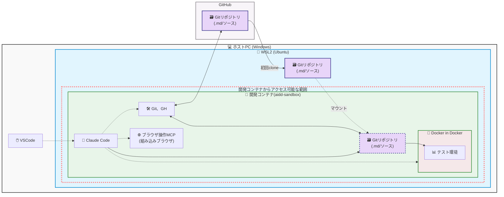

# 開発環境セットアップ

## 開発環境について

### 概要

- Git リポジトリを WSL 上に置く
- VSCode から開発コンテナに接続し、Claude Code を利用する

### 目的

- なぜこんなことをするのか
    - AIを安全なサンドボックス（隔離環境）上で利用できる（AIに直接PC上のファイルを触らせないため、WSL上で構築）
    - WSL 上で構築するため、PCに依存しない。（AWS等への移行が可能）
    - チーム全員が全く同じ開発環境を瞬時に構築できる

## 概要図



## プロジェクトへの導入方法

### プロジェクトへの配置

1. GitHub でリポジトリを作成する

    - Repositories 
      - New
        - Owner を選択
        - Repository name に **プロジェクト名** を入力
        - Choose visibility を **Private** に設定する
        - Start with a template を **KyoshinSystemService/template** に設定する
        - Create repository

    ※ **Private** を忘れると、世界中に公開することになるので、十分に注意すること

2. 作成されたリポジトリを開く
    - Code
      - HTTPS のURLをコピー

3. WSL を開き、git から clone でリポジトリの内容を取得する

    ``` bash
    $ git clone https://kssinet.ghe.com/xxxx/xxxx.git
    ```

    ユーザー名とパスワードを求められたら、ユーザー名には GitHub のユーザー名を、パスワードには端末セットアップ（aidd-setup「ログイン設定」）で発行した PAT を入力する

### template の最新化

- Start with a template でリポジトリを作らなかった場合、このコマンドで後から取り込むことが可能
- template を最新化する場合も、以下のコマンドを実行してください。

1. template の最新化

    ``` bash
    $ .github/pull_upstream.sh
    ```

    ***コンフリクトした場合は、マージしてください***

### 開発コンテナの起動とClaude Codeのセットアップ

1. VS Code を起動し、プロジェクトフォルダを開く
2. VS Code 左下の `><` アイコンをクリックする
3. 「WSL」を選択する
4. 開発コンテナで開きなおす
    - Javaを使う場合は、`.devcontainer\devcontainer.json` のコメントを外す
5. Terminal で、端末セットアップ（aidd-setup「ログイン設定」）で発行した PAT を開発コンテナに登録する

    ``` bash
    $ read -r -s -p "PAT を貼り付けて Enter: " pat; echo; printf '%s' "$pat" | gh auth login --hostname kssinet.ghe.com --with-token; unset pat
    $ gh auth setup-git --hostname kssinet.ghe.com
    $ gh auth status --hostname kssinet.ghe.com
    ```

    - 貼り付けた PAT は画面に表示されない。`gh auth status` で `Logged in to kssinet.ghe.com` と表示されれば成功
    - 開発コンテナを作り直した（Rebuild した）場合は、保管している PAT でこの手順をやり直す。PAT の有効期限が切れた場合は、aidd-setup の手順で PAT を発行し直して `6_login.bat` を再実行してから、使用中のすべての開発コンテナでこの手順をやり直す
6. Terminalから `claude` で Claude Code を起動する（初回および開発コンテナを作り直した後は、Entra ID のシングルサインオンでログインが必要）

## 起動方法

2回目以降、日常的に開発を始めるときの手順です。

1. VS Code を起動し、[開発コンテナ]と書かれているプロジェクトフォルダを開く
2. Terminalから `claude` で Claude Code を起動する
