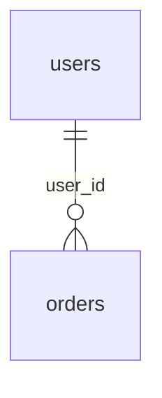

# データモデル定義の運用

<!-- このファイルは書式の定義。実際の定義はテーブルごとに docs/design/data/<テーブル名>.md を作成し、全体像（テーブル一覧・リレーション・共通方針）は docs/design/data/overview.md に記述する -->

データモデル（テーブル定義）をテーブルごとに記録するディレクトリ。命名規則・設計方針は db-design スキルを正とする。スキーマ・マイグレーション・モデルを変更したら、該当テーブルの定義ファイル（全体像に影響する場合は `overview.md` も）を必ず同時更新する（動作規定「振る舞いの制限」・Stop フックで検査される）。初回作成は壁打ち（requirements スキル）で行う。

## ファイル規則
- テーブルごとに `docs/design/data/<テーブル名>.md` を1ファイル作成する（例: `docs/design/data/user_orders.md`）。ファイル名は DB 上のテーブル名（snake_case 複数形）と一致させる
- `overview.md` にはテーブル一覧・リレーション（ER図）・全テーブル共通の方針（削除方針・共通カラム等）を書く。テーブルの追加・削除時は一覧・ER図も同時に更新する
- 各ファイルは常に「現在の定義」だけを表すよう上書き更新する。経緯・変更履歴は書かない（動作規定「振る舞いの制限」。履歴は Git が担う）
- テーブルを削除したら該当ファイルも削除し、`overview.md` の一覧からも除く
- テーブルが増えたらサブフォルダで整理してよい（例: `docs/design/data/受注/orders.md`）。直下の `README.md`（本ファイル）だけは書式定義として固定
- カラム表の「論理名」には、カラム名（ローマ字表記）に対応する日本語の項目名称を記載する（例: `tokuisaki_id` → 得意先ID）。一般的なIT用語のカラム（`id`, `status` 等）も日本語名称を記載する

## テーブル定義ファイルの雛形（`docs/design/data/<テーブル名>.md`）

```markdown
# users

<!-- 書式: docs/design/data/README.md / 全体像: docs/design/data/overview.md / 命名・設計方針: db-design スキル -->

ユーザーアカウント。認証と各種操作の主体。

## カラム
| カラム | 論理名 | 型 | 制約 | 説明 |
|---|---|---|---|---|
| id | ID | BIGINT | PK | |
| email | メールアドレス | VARCHAR(255) | NOT NULL / UNIQUE | ログインID |
| is_active | 有効フラグ | BOOLEAN | NOT NULL / DEFAULT true | 退会で false |
| created_at | 作成日時 | TIMESTAMP | NOT NULL | |
| updated_at | 更新日時 | TIMESTAMP | NOT NULL | |

## インデックス
| 名前 | 対象 | 種別 |
|---|---|---|
| idx_users_email | email | UNIQUE |

## リレーション
- has many: `orders`（`orders.user_id` → `users.id`）

## 備考
- 全テーブル共通の前提（削除方針等）は overview.md に従う。このテーブル固有の制約・非自明な業務ルールだけをここに書く
```

## 全体像ファイルの雛形（`docs/design/data/overview.md`）

````markdown
# データモデル全体像

<!-- 書式: docs/design/data/README.md / テーブルごとの定義: docs/design/data/<テーブル名>.md -->

## テーブル一覧
| テーブル | 概要 |
|---|---|
| [users](users.md) | ユーザーアカウント |
| [orders](orders.md) | 注文 |

## リレーション（ER図）


## 共通方針
- 削除方針: 物理削除（論理削除が必要なテーブルは個別ファイルに明記）
- 共通カラム: `created_at` / `updated_at` を全テーブル必須とする（db-design スキル）
````
